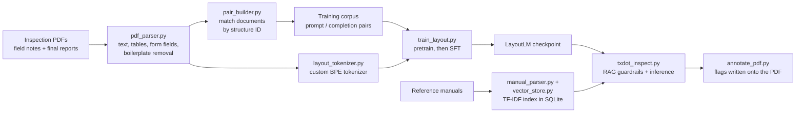

# Inspection QA Model

**A from-scratch transformer and document pipeline for checking bridge inspection reports.**

> **Status: research prototype.** The full pipeline runs end to end, but the model's output is not yet reliable enough for real use. The [Results](#results-so-far) and [Known limitations](#known-limitations) sections explain where it stands and why.

Bridge inspection reports go through several drafts. An inspector's shorthand field notes become a first draft, which an engineer reviews into a final report. Errors such as a component rating that doesn't match the notes, a dropped finding, or a missing field are caught by hand during review. This project trains a small language model to act as a **first-pass QA checker**: it compares field notes against a draft report and flags discrepancies *before* the draft reaches an engineer. It is meant to support engineering judgment, not replace it, and it does not write reports.

I built it while working as a bridge inspector on state DOT inspection programs. Everything runs locally. Inspection records are confidential, so no data leaves the machine, and **no real data, trained weights, or trained tokenizer is included in this repository**. A synthetic data generator is included so the pipeline can be run end to end.

## How it works



**1. Parsing (`pdf_parser.py`).** Inspection PDFs are dense multi-column forms, and naive text extraction scrambles them. The parser:
- uses pdfplumber's position-sorted extraction, with pypdf as a fallback, so adjacent form labels don't bleed together;
- reads true AcroForm fields from the PDF's form structure instead of guessing `label: value` pairs from text;
- detects borderless tables (element / rating / comment) with text-alignment table detection;
- skips table detection on CAD and plan sheets, which can otherwise hang for hours on thousands of vector objects;
- strips lines repeated across most pages (banners, header blocks), which otherwise flooded the training corpus with duplicated boilerplate.

**2. Pairing (`pair_builder.py`).** It matches each bridge's field notes to its final report using the structure-ID folder name. Canonical document types take priority, and matching falls back to year and then to most recent.

**3. Tokenizer (`layout_tokenizer.py`).** A SentencePiece BPE tokenizer is trained on the project's own documents. Its special tokens describe page structure (pages, blocks, tables, cells, form fields, page zones, font sizes, and task types).

**4. Model (`layout_model.py`).** A decoder-only transformer written from scratch in PyTorch:

| Component | Choice |
|---|---|
| Size | 81.4M parameters (`small` config, ~6.5k-token vocabulary) |
| Layers / width | 12 layers, d_model 768 |
| Attention | Grouped-query attention: 12 query heads, 4 key/value heads |
| Positions | Rotary position embeddings (RoPE) |
| Feed-forward | SwiGLU |
| Normalization | RMSNorm (pre-norm), tied input/output embeddings |
| Layout features | 2D page-zone, block-type, and font-style embeddings (implemented; see limitations) |
| Decoding | Top-k / top-p sampling, repetition penalty, n-gram blocking |

**5. Training (`train_layout.py`).** Training runs in two phases:
- **Pretraining:** next-token prediction on all parsed documents.
- **Supervised fine-tuning (SFT):** on prompt/completion pairs, with loss masked over the prompt so the model is trained only on its output, and an end-of-sequence token appended so it learns to stop.

It uses AdamW with weight decay applied only to weight matrices, linear warmup followed by cosine decay, gradient accumulation and clipping, and keeps the checkpoint with the best validation loss.

**6. Inference with guardrails (`txdot_inspect.py`, `rag_engine.py`).** Reference-manual sections are indexed with TF-IDF in SQLite. At inference, the sections relevant to the document are retrieved and injected into the prompt as guardrails, along with NBI condition-rating definitions and rating-consistency checks. Model output is written back onto the PDF as color-coded annotations with a summary page (`annotate_pdf.py`). `tools/make_gguf.py` exports a checkpoint to GGUF so it can be served locally in LM Studio.

## Results so far

The pipeline works end to end, and training is stable. On my real dataset, training loss fell from about 30 to about 4 within roughly 200 optimizer steps. **Generation quality is not yet usable.** On held-out examples, the model produced:
- structurally malformed QA flags;
- hallucinated fields and invented rating categories;
- leaked special tokens;
- failures to stop generating.

I traced this to two compounding causes:
1. **Noisy training data.** A confidentiality banner and repeated header blocks were extracted once per page. The cross-page filter in `pdf_parser.py` removes lines repeated across most pages. pdfplumber sometimes fused the banner mid-line with real content, though, which whole-line matching can't catch, so a second, fragment-level filter is the next fix.
2. **A corpus that is small for an 81M-parameter model trained from scratch.** The next step is rebuilding the corpus with the cleaned parser, then expanding it.

**Bugs found and fixed along the way:**
- **Learning-rate schedule on resume.** Resuming from a checkpoint near `max_steps` restarted the schedule at the absolute step count, landing training in the near-zero tail of the cosine decay. The schedule now runs relative to the resume point.
- **Validation split.** It consumed a fixed number of examples regardless of dataset size. It is now proportional: 10% of the data, between 5 and 50 examples.
- **Table crash in `txdot_inspect.py`.** Analysis crashed on any PDF containing a table because table cells were read as attributes rather than dictionary keys.
- **Retrieval query map.** A duplicate key silently overwrote one set of scour search queries.

## Try it on synthetic data

```bash
pip install -r requirements.txt
python examples/make_demo_data.py   # 6 fake bridges + a sample reference guide

# Parse and pair
python pdf_parser.py --pdf-dir ./data/raw_pdfs/field_notes   --output-dir ./data/processed/field_notes
python pdf_parser.py --pdf-dir ./data/raw_pdfs/final_product --output-dir ./data/processed/final_product
python pair_builder.py match
python pair_builder.py build

# Tokenizer and a short pretraining run (needs a GPU or ~16 GB RAM)
python layout_tokenizer.py build-pretrain --parsed-dir ./data/processed --output ./data/pretrain_corpus.txt
python layout_tokenizer.py train-tokenizer --corpus ./data/pretrain_corpus.txt --prefix ./tokenizer/layout_bpe --vocab-size 400
python train_layout.py pretrain --corpus ./data/pretrain_corpus.txt --tokenizer ./tokenizer/layout_bpe.model --max-steps 50 --max-seq-len 512

# Retrieval guardrails
python txdot_inspect.py build-db --manual-dir ./manuals/raw
python txdot_inspect.py test-rag --query "spalling on bent cap rated 4 poor"
```

Every bridge ID in the demo uses the `00-000-0000-00-NNN` placeholder range, and every note and rating is invented. Some final reports deliberately change a rating from the field notes, so the pairs contain the kind of discrepancy the checker should flag.

**Note on SFT steps:** `--max-steps` counts *total* optimizer steps, including the pretraining steps carried in from the checkpoint. To fine-tune for 3,000 steps after 10,000 pretraining steps, pass `--max-steps 13000`. A smaller value finishes immediately without training.

## Known limitations

- **Layout embeddings aren't used in training yet.** The model defines spatial, block-type, and font embeddings, but the current training and inference paths pass only token IDs. Layout information reaches the model only through the special tokens in the text.
- **Positions are approximate.** The parser assigns text blocks synthetic coordinates (full width, evenly spaced by line), so page-zone features carry limited information.
- **Annotation placement and severity.** Every finding is attached to page 1, and severity comes from keywords, so a rating-change flag is labeled "info" rather than "warning."
- **Repetition penalty conflicts with the task.** The penalty also applies to prompt tokens, which discourages the model from quoting values from its input. A checker that must say *draft states "5"* needs to quote.
- **Batch size 1 for generation.** `generate()` currently supports one sequence at a time.
- **Legacy `[EOS]` in an unused path.** The older `build-sft` path in `layout_tokenizer.py` writes a literal `[EOS]` string, which the tokenizer encodes as the unknown token, not the end-of-sequence ID. The current SFT path in `train_layout.py` appends the real end-of-sequence ID.

## Repository layout

```
pdf_parser.py        PDF / PPTX / XLSX -> structured JSON
pair_builder.py      field notes <-> final report pairing, SFT corpus
layout_tokenizer.py  layout token stream, BPE tokenizer training
layout_model.py      the transformer
train_layout.py      pretraining and SFT
eval_review.py       generate on the held-out split and compare to ground truth
manual_parser.py     reference manuals -> sections
vector_store.py      TF-IDF + SQLite section index
rag_engine.py        retrieval, guardrails, citations
txdot_inspect.py     end-to-end analysis entry point
annotate_pdf.py      writes findings onto the PDF
examples/            synthetic demo data generator
tools/               data-inspection scripts, GGUF export
```

**Not included:** real inspection documents, reference manuals, trained checkpoints, the trained tokenizer, and the QA corpus builder (three-way field notes × draft × final matching).

## License

MIT
